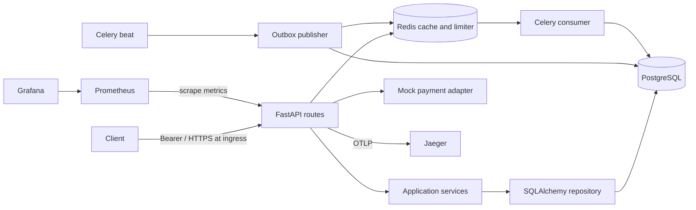
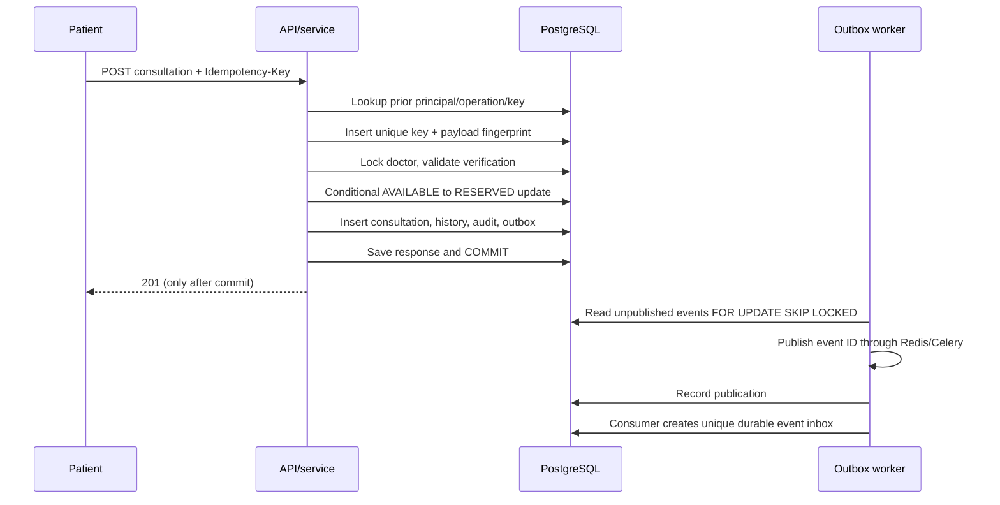
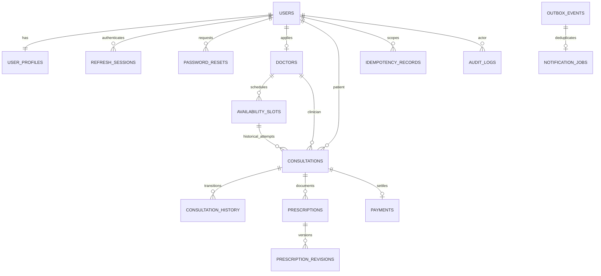

# Architecture

## Overview and decisions

Amrutam is a modular FastAPI application with service boundaries for identity, users, doctors/availability, consultations, prescriptions, payments, analytics and audit. Thin API handlers validate Pydantic input and inject a SQLAlchemy repository and service adapters. A Celery worker handles durable outbox events and a single beat scheduler runs publication and reconciliation. PostgreSQL is authoritative; Redis provides fixed-window authentication rate limiting, public-profile caching and the initial job broker. SQLite supports a deliberately smaller local execution environment.

A modular monolith keeps booking, audit, state history and outbox changes in one ACID transaction. Extract notifications first if independently measured queue throughput or operational ownership warrants it. Extract search only when indexed PostgreSQL queries repeatedly miss latency budgets despite tuning. Extract booking only after profiling proves a separate scaling boundary; preserve one authoritative reservation database. Folder count alone does not justify services.

## Request and event flow

Authentication validates signed, expiring JWTs and checks the associated durable refresh session on every request. Refresh rotation revokes the old session; reuse revokes its family. Logout and password reset revoke sessions immediately. MFA enrollment encrypts the TOTP secret and verification consumes a timestep atomically. One-use recovery hashes provide a recovery path. Privileged routes require both an enabled MFA configuration and an MFA-authenticated session.

Doctor applications encrypt license and qualification values. An administrator reads credentials through an audited endpoint, verifies externally, then sets verification status. Public doctor projections exclude credentials and user identity. Slot creation locks the doctor's row; PostgreSQL also rejects overlapping active intervals through a GiST exclusion constraint. Adjacent intervals are allowed.

The unique idempotency key serializes simultaneous duplicate requests. On a unique-key failure, the service rolls back and reloads the committed response, rejecting a different fingerprint. A partial unique index independently prohibits multiple active consultations for a slot. No Redis lock participates in booking correctness. Failed transactions release both the reservation and idempotency insertion. Responses contain no plaintext medical data in the idempotency table.

## Data relationships

All primary IDs are UUID strings. Foreign keys default to restrictive deletion to protect history. Fee and medication inputs are bounded. Prescription bodies, reasons, MFA secrets and professional credentials use authenticated Fernet encryption; database volume encryption covers other personal fields. Audit logs never contain medical payloads or credentials. PostgreSQL triggers reject changes to audit, consultation history and prescription revision rows. A database owner can bypass these controls: operational separation and external immutable archival remain necessary.

## State machine, payments and compensation

`BOOKED → CONFIRMED → IN_PROGRESS → COMPLETED`. Only a valid successful payment confirms a booking. The assigned doctor starts within the scheduled interval and then completes it. Cancellation is allowed from booked/confirmed; an unpaid booking can become expired or payment-failed. Terminal states cannot return to active states. Completed consultations retain their slot reservation.

Payment creation is naturally idempotent per consultation. The provider abstraction is injected and the included adapter only simulates money movement. HMAC-SHA256 webhooks require a timestamp within five minutes, the correct reference, amount and currency. Unique event IDs prevent duplicate processing and altered event bodies are rejected. Consultation-before-payment row locking is shared by webhook and cancellation paths to avoid lock-order inversion.

The booking/payment saga reserves first, creates a payment intent, then confirms from a verified event. Failure or expiry releases the slot. Cancellation after payment creates a durable refund event; the worker records a mock refund. A delayed success after expiry/cancellation schedules compensation rather than resurrecting the reservation. Contradictory provider terminal events require investigation; a real adapter must add provider polling and operator reconciliation before money is accepted.

## Reliability and caching

Outbox delivery is at least once. Publication happens before marking published, so crashes can duplicate delivery. Consumer event IDs are unique in the database. Worker acknowledgements occur after processing; bounded exponential retry uses jitter. Unconsumed events older than ten minutes are eligible for republication. Reservations expire in batches of 100 once per minute. Notification jobs form a local durable inbox; external delivery and its own idempotency contract are intentionally pending.

Redis limiter failure returns 503 when Redis is required. Cache failure falls back to PostgreSQL; only public doctor projections are cached for 30 seconds. Cache keys are `doctor:{uuid}`; updates become visible after TTL expiration. Search and availability use current indexed queries, avoiding stale slot correctness decisions. No patient records or prescriptions enter Redis caches.

Connection pools permit 10 steady plus 10 overflow connections per process, with five-second pool acquisition and statement deadlines and a three-second lock deadline. At ten replicas the worst case is 200 API connections, excluding workers: budget this against the RDS limit and add PgBouncer before scaling beyond it. Liveness has no dependency checks; readiness checks PostgreSQL and required Redis. Processes dispose connections at shutdown; Kubernetes grants 45 seconds for draining.

## Capacity, observability and recovery

100,000 consultations/day averages 1.16 bookings/sec. Assuming 30 API calls per consultation gives 3 million calls/day, or 34.7 RPS average. A 10x peak implies about 347 RPS and 12 booking writes/sec, with separate 100-way contention bursts. Assume 90% reads, 5 KB per consultation plus indexes/history (~1 GB/day before prescriptions/audit) and 60% public-profile cache hits; these are sizing inputs, not measurements. Archive old outbox/reset data and consider monthly consultation/audit partitioning only after index growth and query plans justify a migration. Do not partition away global reservation uniqueness.

HTTP counters and latency histograms label route templates, methods and status, never user IDs. JSON logs include server-generated request ID, timestamp, route, duration, status and trace ID. Metrics include DB cursor latency, checked-out API connections, cache outcomes, booking outcomes, webhook outcomes and outbox backlog. Optional OTLP instrumentation covers inbound/outbound HTTP, Redis and Celery; DB spans use sanitized operation metadata. Grafana and alerts are provisioned. Worker counters require a separate production scrape/export strategy.

Target availability is 99.95% (roughly 22 minutes/month), with multi-AZ compute/database, private dependencies and rolling updates. RDS retains 35 days for PITR. Objectives: database RPO ≤5 minutes, RTO ≤60 minutes for an AZ incident; regional recovery requires cross-region backup replication and tested key availability and is not implemented. Quarterly restore drills must verify medical decryption and audit consistency. See backup-and-recovery.md.

Production gaps include jurisdiction-specific consent/retention workflows, external notifications, real payment reconciliation, managed secret injection, TLS ingress, pen testing, restore drills and measured load/SLO validation. Terraform passes local provider-schema validation; Terraform and Kubernetes remain deployment references until exercised against a configured account. No compliance certification or production capacity is asserted.
